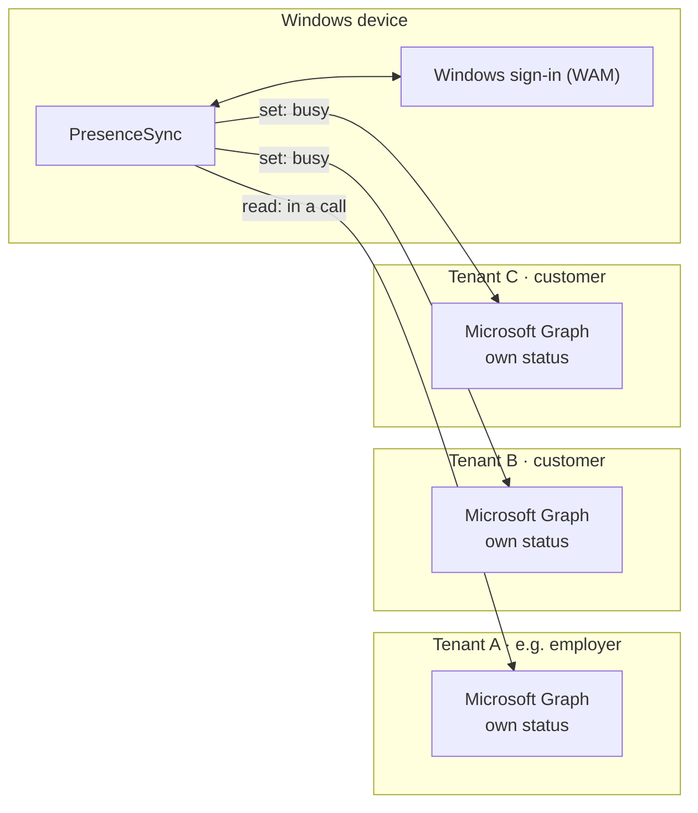

# PresenceSync

**One Teams status for all tenants.** PresenceSync is a small Windows notification-area app that keeps your
Microsoft Teams status in sync across multiple Microsoft Entra ID tenants and lets you control it from one place.

[](https://github.com/Lars-Level21/presencesync/actions/workflows/ci.yml)
[](LICENSE)

## The problem

Consultants, service providers and freelancers often work with **their own accounts in several customer tenants** and
are signed in to all of them at the same time in the Teams client. But the Teams status is **separate per tenant**:

- If you are on a call in your employer's tenant, every customer still sees you as "Available" – and calls or messages
  you even though you can't respond.
- To set "Do not disturb", you have to switch to each organization in the Teams client and set the status there.
  In day-to-day project work, nobody does that.

## The solution

PresenceSync signs in to each tenant with the respective account and uses the official Microsoft Graph presence APIs:

- **Auto-sync:** When you are in a call, in a meeting, presenting or set to "Do not disturb" in one tenant, you appear
  as "Busy" or "Do not disturb" in all other tenants. Afterwards the status reverts on its own.
- **Manual control:** Set the status for all or individual tenants directly from the notification area – Available,
  Busy, Do not disturb, Be right back, Away – for 30 min, 1 h, 2 h, until end of day or unlimited.
  Two clicks, no switching organizations in the Teams client.
- **Teams has the last word:** The app creates its own presence session, which Teams merges with the user's other
  sessions. A status set manually in Teams is not overwritten; if the app crashes, its status expires on its own after
  5 minutes.



**Key principles**

| | |
| --- | --- |
| Runs | locally on Windows 10/11 in the user context – no server, no backend, no telemetry |
| Access | only the user's **own** Teams status; delegated permissions `User.Read`, `Presence.ReadWrite`, `offline_access` |
| Sign-in | Microsoft Entra ID via the Windows token broker (WAM); the tenants' MFA and Conditional Access apply unchanged |
| Between tenants | only the signal "busy / do not disturb" – no call partners, content or appointments |
| Network endpoints | `login.microsoftonline.com`, `graph.microsoft.com` |

Details on components, sync logic and data flows: **[docs/architecture.md](docs/architecture.md)**

## The app

- **Left-click the tray icon** to open a window above the taskbar: overall status, one card per tenant with its
  status, quick actions for all tenants and the "Auto-sync" toggle.
- **Right-click** opens a compact menu with the same functions.
- **Settings:** add tenants via the Windows account picker (tenant ID and name are filled in automatically),
  polling interval, autostart, global keyboard shortcuts (e.g. "All → Do not disturb 1 h").
- The status icons match Teams; the UI follows the Windows 11 style and light or dark mode.
- The UI is shown in the user's Windows display language (English by default, German if Windows is set to German).

| Tray icon | Meaning |
| --- | --- |
| green with check mark | all available |
| red / red with bar | busy or "Do not disturb" somewhere – sync active |
| gray ring | auto-sync off or offline |
| orange with "!" | at least one tenant needs a sign-in or is blocked |

## Quick start (single user)

1. **Create an app registration** in your own home tenant – once, with
   [`scripts/New-AppRegistration.ps1`](scripts/New-AppRegistration.ps1), see
   [docs/deployment.md → App registration](docs/deployment.md#1-app-registration). The `appId` it outputs is the
   **client ID**.
2. **Start the app:** download `PresenceSync.exe` from the [latest release](https://github.com/Lars-Level21/presencesync/releases/latest) (checksum: see
   [SECURITY.md](SECURITY.md)) or build it yourself. The exe is not signed, so Windows SmartScreen warns the first time
   you run a downloaded file – *More info → Run anyway*. To build it yourself:

   ```bash
   dotnet publish src/PresenceSync.App -c Release -o publish
   ```

3. **Set up:** Settings open on first start. Enter the client ID, then for **each** tenant – including your own home
   tenant – choose *Add tenant → Choose account …* and sign in with the respective account.
   **Save.** Auto-sync needs at least two active tenants.

If a customer tenant asks for admin approval, contact the customer's IT using the
[request template](docs/consent-request-template.md) and [docs/consent.md](docs/consent.md).

## For IT departments: deploying PresenceSync in your organization

Organizations create **one** app registration, set its client ID and optionally the home tenant via policy (Intune
or Group Policy, ADMX templates included) and distribute the app, e.g. as an Intune Win32 app. Employees cannot
change these settings and only need to add their customer tenants; the home tenant signs in automatically with the
Windows account.

→ **[docs/deployment.md](docs/deployment.md)**: app registration, publisher verification, policies, distribution,
troubleshooting

## For customer tenant admins: consent

If an external employee wants to use PresenceSync with their account in your tenant, the app needs consent for three
delegated low-privilege permissions. Consent can be restricted to exactly this one user and revoked at any time.

→ **[docs/consent.md](docs/consent.md)**: permissions and endpoints used, security, consent for a single user,
monitoring and revoking, FAQ

## Security

| | |
| --- | --- |
| [SECURITY.md](SECURITY.md) | Security model, known limitations, reporting vulnerabilities, release checksums |

## Further documentation

| | |
| --- | --- |
| [docs/architecture.md](docs/architecture.md) | Components, sign-in, sync logic, data flows, stored data |
| [docs/development.md](docs/development.md) | Building, testing, project structure, release |
| [docs/spec.md](docs/spec.md) | Original requirements and implementation notes |

## License

[MIT](LICENSE) – © 2026 Lars Martin
