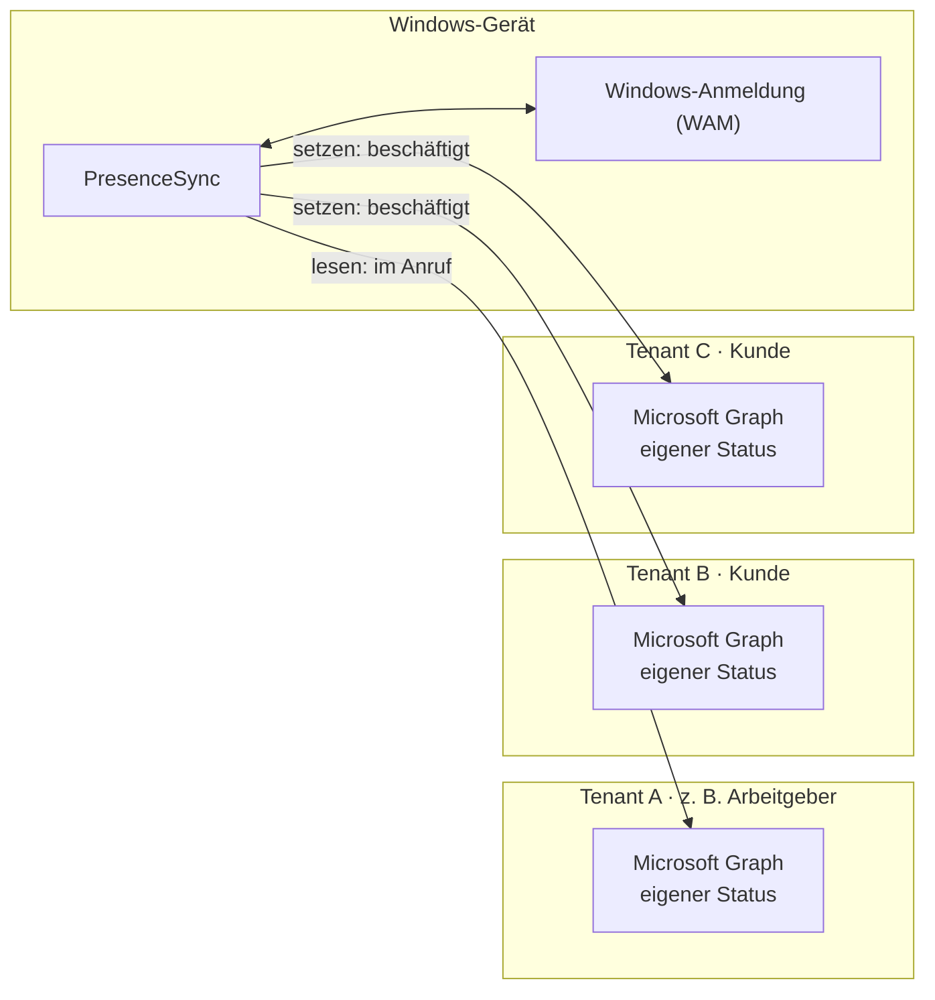

# PresenceSync

**Ein Teams-Status für alle Tenants.** PresenceSync ist eine kleine Windows-App für den Infobereich, die den
Microsoft-Teams-Status über mehrere Microsoft-Entra-ID-Tenants hinweg abgleicht und zentral steuerbar macht.

[](https://github.com/Lars-Level21/presencesync/actions/workflows/ci.yml)
[](LICENSE)

## Das Problem

Berater, Dienstleister und Freelancer arbeiten oft mit **eigenen Konten in mehreren Kunden-Tenants** und sind im
Teams-Client in allen gleichzeitig angemeldet. Der Teams-Status ist aber **pro Tenant getrennt**:

- Wer im Tenant des Arbeitgebers telefoniert, erscheint bei allen Kunden weiter als „Verfügbar“ – und wird
  angerufen oder angeschrieben, obwohl er nicht reagieren kann.
- Wer „Nicht stören“ setzen will, muss im Teams-Client jede Organisation einzeln wechseln und den Status dort setzen.
  Im Projektalltag macht das niemand.

## Die Lösung

PresenceSync meldet sich mit dem jeweiligen Konto in jedem Tenant an und nutzt die offiziellen
Microsoft-Graph-Presence-APIs:

- **Auto-Sync:** Ist man in einem Tenant im Anruf, in einer Besprechung, präsentiert oder auf „Nicht stören“,
  erscheint man in allen anderen Tenants als „Beschäftigt“ bzw. „Nicht stören“. Danach fällt der Status von selbst
  zurück.
- **Manuelle Steuerung:** Status für alle oder einzelne Tenants direkt aus dem Infobereich setzen – Verfügbar,
  Beschäftigt, Nicht stören, Gleich zurück, Abwesend – jeweils für 30 min, 1 h, 2 h, bis Tagesende oder unbegrenzt.
  Zwei Klicks, ohne Organisationswechsel im Teams-Client.
- **Teams behält das letzte Wort:** Die App legt eine eigene Presence-Session an, die Teams mit den übrigen Sessions
  des Benutzers zusammenführt. Ein in Teams manuell gesetzter Status wird nicht überschrieben; stürzt die App ab,
  läuft ihr Status nach 5 Minuten von selbst aus.



**Grundprinzipien**

| | |
| --- | --- |
| Läuft | lokal unter Windows 10/11 im Benutzerkontext – kein Server, kein Backend, keine Telemetrie |
| Zugriff | ausschließlich der **eigene** Teams-Status; delegierte Berechtigungen `User.Read`, `Presence.ReadWrite`, `offline_access` |
| Anmeldung | Microsoft Entra ID über den Windows-Token-Broker (WAM); MFA und Conditional Access der Tenants gelten unverändert |
| Zwischen Tenants | nur das Signal „belegt / nicht stören“ – keine Gesprächspartner, Inhalte oder Termine |
| Netzwerkziele | `login.microsoftonline.com`, `graph.microsoft.com` |

Details zu Komponenten, Sync-Logik und Datenflüssen: **[docs/architecture.md](docs/architecture.md)**

## Die App

- **Linksklick aufs Tray-Symbol** öffnet ein Fenster über der Taskleiste: Gesamtstatus, pro Tenant eine Karte mit
  Status, Schnellaktionen für alle Tenants und der Schalter für Auto-Sync.
- **Rechtsklick** öffnet ein kompaktes Menü mit denselben Funktionen.
- **Einstellungen:** Tenants per Windows-Kontoauswahl hinzufügen (Tenant-ID und Name werden automatisch übernommen),
  Abfrageintervall, Autostart, globale Tastenkürzel (z. B. „Alle → Nicht stören 1 h“).
- Die Statussymbole entsprechen Teams; die Oberfläche folgt dem Windows-11-Stil und dem hellen bzw. dunklen Modus.

| Tray-Symbol | Bedeutung |
| --- | --- |
| grün mit Haken | alle verfügbar |
| rot / rot mit Balken | irgendwo beschäftigt bzw. „Nicht stören“ – Sync aktiv |
| grauer Ring | Auto-Sync aus oder offline |
| orange mit „!“ | mindestens ein Tenant braucht eine Anmeldung oder ist gesperrt |

## Schnellstart (Einzelnutzer)

1. **App-Registrierung** im eigenen Home-Tenant anlegen – einmalig, mit
   [`scripts/New-AppRegistration.ps1`](scripts/New-AppRegistration.ps1), siehe
   [docs/deployment.md → App-Registrierung](docs/deployment.md#1-app-registrierung). Die ausgegebene `appId` ist die
   **Client-ID**.
2. **App starten:** `PresenceSync.exe` aus dem [neuesten Release](https://github.com/Lars-Level21/presencesync/releases/latest) herunterladen (Prüfsumme siehe
   [SECURITY.md](SECURITY.md)) oder selbst bauen. Die Exe ist nicht signiert; Windows SmartScreen warnt deshalb beim
   ersten Start einer heruntergeladenen Datei – *Weitere Informationen → Trotzdem ausführen*. Selbst bauen:

   ```bash
   dotnet publish src/PresenceSync.App -c Release -o publish
   ```

3. **Einrichten:** Beim ersten Start öffnen sich die Einstellungen. Client-ID eintragen, dann für **jeden** Tenant –
   auch den eigenen Home-Tenant – *Tenant hinzufügen → Konto auswählen …* und mit dem jeweiligen Konto anmelden.
   **Speichern.** Auto-Sync braucht mindestens zwei aktive Tenants.

Fordert ein Kunden-Tenant eine Administratorgenehmigung an, die Kunden-IT mit der
[Anfrage-Vorlage](docs/consent-request-template.md) und [docs/consent.md](docs/consent.md) ansprechen.

## Für IT-Abteilungen: PresenceSync in der Organisation bereitstellen

Organisationen legen **eine** App-Registrierung an, geben deren Client-ID und optional den Home-Tenant per
Richtlinie vor (Intune oder Gruppenrichtlinie, ADMX-Vorlagen liegen bei) und verteilen die App, z. B. als
Intune-Win32-App. Mitarbeiter können die Vorgaben nicht ändern und müssen nur noch ihre Kunden-Tenants hinzufügen;
der Home-Tenant meldet sich mit dem Windows-Konto automatisch an.

→ **[docs/deployment.md](docs/deployment.md)**: App-Registrierung, Herausgeber-Verifizierung, Richtlinien,
Verteilung, Fehlerbilder

## Für Admins der Kunden-Tenants: Zustimmung (Consent)

Möchte ein externer Mitarbeiter PresenceSync mit seinem Konto in Ihrem Tenant verwenden, braucht die App die
Zustimmung zu drei delegierten Low-Privilege-Berechtigungen. Die Freigabe lässt sich auf genau diesen einen Benutzer
beschränken und jederzeit widerrufen.

→ **[docs/consent.md](docs/consent.md)**: Berechtigungen und verwendete Endpunkte, Sicherheit, Zustimmung nur für
einen Benutzer, Überwachen und Widerrufen, FAQ

## Sicherheit

| | |
| --- | --- |
| [docs/security-review.md](docs/security-review.md) | Ergebnis des Security-Reviews und offene Punkte |
| [SECURITY.md](SECURITY.md) | Sicherheitslücken melden, Prüfsummen der Releases |

## Weitere Dokumentation

| | |
| --- | --- |
| [docs/architecture.md](docs/architecture.md) | Komponenten, Anmeldung, Sync-Logik, Datenflüsse, gespeicherte Daten |
| [docs/development.md](docs/development.md) | Bauen, Testen, Projektstruktur, Release |
| [docs/spec.md](docs/spec.md) | Ursprüngliche Anforderungen und Umsetzungsnotizen |

## Lizenz

[MIT](LICENSE) – © 2026 Lars Martin
