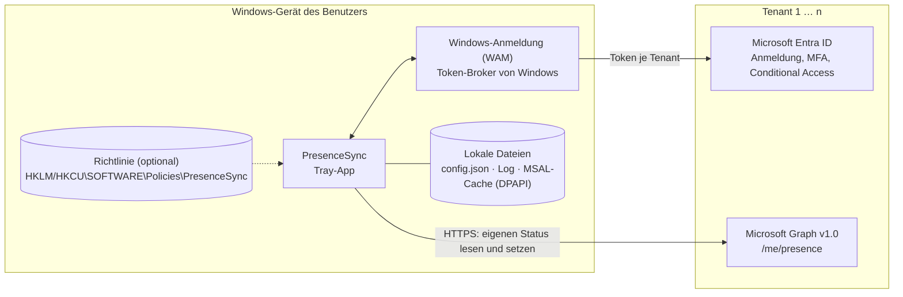
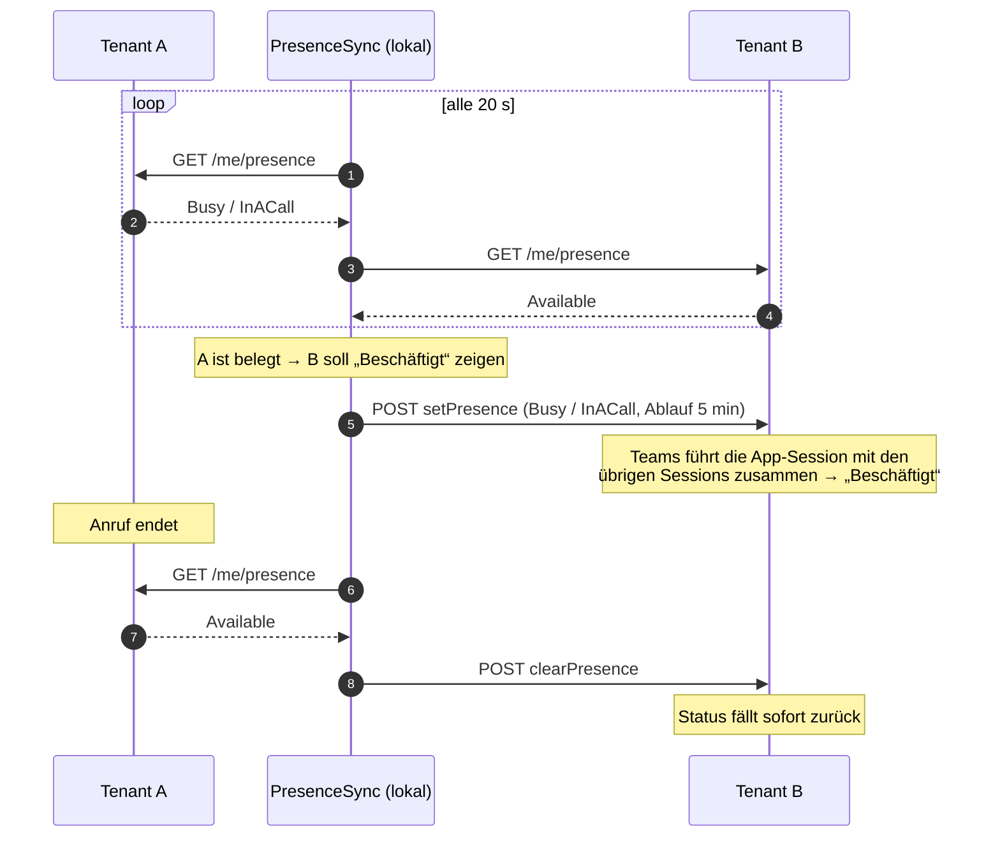

# Architektur

Technische Referenz zu PresenceSync: Komponenten, Anmeldung, Sync-Logik, Graph-Aufrufe, Datenflüsse und lokal
gespeicherte Daten. Überblick: [README](../README.md). Berechtigungen und Zustimmung aus Sicht eines Kunden-Tenants:
[consent.md](consent.md).

## Überblick

- **Lokal, ohne Backend:** Es gibt keinen Server des Herausgebers. Die einzigen Netzwerkziele sind
  `login.microsoftonline.com` und `graph.microsoft.com`.
- **Ein Anmeldekontext pro Tenant:** Für jeden Tenant meldet sich der Benutzer mit seinem dortigen Konto an. Token eines
  Tenants werden nie gegen einen anderen Tenant verwendet.
- **Nur offizielle APIs:** Microsoft Graph v1.0 mit eigener App-Registrierung und delegierten Berechtigungen; keine
  First-Party-Client-IDs, keine undokumentierten Endpunkte.

## Komponenten

| Projekt | Aufgabe | Abhängigkeiten |
| --- | --- | --- |
| `src/PresenceSync.Core` | Sync-Entscheidungen (`SyncPlanner`, reine Funktion), Zustandsmaschine (`SyncEngine`), Konfiguration und Richtlinien (`PolicyApplier`), Texte, Fehlerkatalog, Log-Filter | nur `Microsoft.Extensions.Logging.Abstractions` – kein UI, kein HTTP, kein MSAL; vollständig unit-getestet |
| `src/PresenceSync.Graph` | Anmeldung mit MSAL und WAM pro Tenant (`TenantAuthenticator`), schlanker Graph-Client, Abbildung von Fehlern auf `AuthRequired` / `Disabled` / `Throttled` / `Transient` | Core, MSAL |
| `src/PresenceSync.App` | WPF-Oberfläche (WPF-UI, Fluent), Tray-Symbol (H.NotifyIcon), Einstellungen, Polling-Schleife, Windows-Ereignisse, Logging (Serilog) | Core, Graph |
| `tests/PresenceSync.Core.Tests` | xUnit; ein simuliertes Teams (`FakePresenceGateway`) bildet die Status-Zusammenführung von Graph nach | Core |

Laufzeit: .NET 10, ausgeliefert als eigenständige Einzeldatei `PresenceSync.exe` (win-x64), keine Installation
und keine Administratorrechte nötig.

## Anmeldung

- **MSAL mit Windows-Broker (WAM):** Die App verwendet dieselbe Windows-Anmeldung wie Teams und Office – Single
  Sign-on, MFA, Gerätezustand und Conditional Access der jeweiligen Tenants gelten unverändert. Ist WAM nicht
  verfügbar, fällt MSAL auf den Systembrowser zurück.
- **Pro Tenant eine feste Authority** `https://login.microsoftonline.com/{tenant-id}`. Nur beim Hinzufügen eines
  Tenants über die Kontoauswahl wird einmalig `organizations` verwendet; die Tenant-ID wird aus dem Ergebnis gelesen.
  Gastkonten geben die Tenant-ID dabei explizit an.
- **Hintergrund-Token** werden still erneuert (`offline_access`). Scheitert das (MFA fällig, Consent widerrufen,
  Conditional Access), zeigt die App „Anmeldung erforderlich“ bzw. „Gesperrt“ mit dem Grund im Klartext. **Ein
  Anmeldedialog öffnet sich nie automatisch**, nur nach Klick des Benutzers.
- **Ein Konto pro Tenant.** Wählt der Benutzer für einen bereits eingerichteten Tenant ein anderes Konto, fragt die
  App nach und zeigt bisheriges und neues Konto (Mitglied oder Gast).
- **Verwalteter Home-Tenant:** Gibt eine Richtlinie den Home-Tenant vor, meldet sich die App mit dem Windows-Konto
  ohne Interaktion an – nur wenn dieses ein Mitgliedskonto genau dieses Tenants ist.

## Sync-Logik

Die App fragt den eigenen Status aller aktiven Tenants parallel ab, standardmäßig alle 20 Sekunden.

1. **Quellen bestimmen:** Ein Tenant ist *Quelle*, wenn der Benutzer dort im Anruf, in einer Telefonkonferenz, in
   einer Besprechung ist, präsentiert oder auf „Nicht stören“ steht – und die App dort **keine** eigene Session hält.
2. **Ziele setzen:** Gibt es mindestens eine Quelle, setzt die App in allen anderen aktiven Tenants per
   `setPresence` eine eigene Session: `Busy/InACall`, bzw. `DoNotDisturb/Presenting`, wenn die Quelle auf „Nicht
   stören“ steht oder präsentiert. Ablauf 5 Minuten; erneuert wird erst, wenn weniger als 2 Minuten übrig sind.
3. **Zurücksetzen:** Gibt es keine Quelle mehr, beendet die App ihre Sessions sofort mit `clearPresence`.

Regeln, die Fehlverhalten verhindern:

| Regel | Zweck |
| --- | --- |
| Ein Tenant mit eigener App-Session ist nie Quelle | Keine Rückkopplung (A setzt B, B setzt A …) |
| Nach dem Beenden einer Session wird derselbe Status 60 s lang nicht als Quelle gewertet | Graph meldet den alten Status noch kurz nach; ohne Schutz entstünde ein Ping-Pong |
| Manueller Status hat Vorrang | Solange der Benutzer in einem Tenant manuell einen Status gesetzt hat, setzt der Sync dort nichts |
| Teams-Präzedenz: manuell > Sessions; DnD > Beschäftigt > Verfügbar > Abwesend | Die App überschreibt nichts hart; ein in Teams gesetztes „Nicht stören“ bleibt bestehen |

Bekannte Einschränkung: Beginnt in einem Tenant, in dem die App gerade eine eigene Session hält, ein echter Anruf,
erkennt die App ihn erst als Quelle, wenn ihre Session beendet ist – Graph liefert nur den zusammengeführten Status.

## Graph-Aufrufe

Vollständige Liste, alle Microsoft Graph v1.0, alle im Kontext des angemeldeten Benutzers:

| Aufruf | Zweck | Häufigkeit |
| --- | --- | --- |
| `GET /me/presence` | eigenen Status lesen | alle 20 s (einstellbar 10–300 s) |
| `GET /me?$select=id` | eigene Objekt-ID, falls noch unbekannt | einmalig |
| `GET /organization?$select=displayName` | Name des Tenants als Vorschlag für die Beschriftung | einmalig beim Hinzufügen |
| `POST /users/{eigene ID}/presence/setPresence` | eigene App-Session setzen bzw. erneuern | während eines Anrufs in einem anderen Tenant ca. alle 3 min |
| `POST /users/{eigene ID}/presence/clearPresence` | eigene App-Session beenden | bei Ende des Anrufs, beim Beenden der App, bei Windows-Abmeldung |
| `POST /users/{eigene ID}/presence/setUserPreferredPresence` | manueller Status | nur auf Klick des Benutzers |
| `POST /users/{eigene ID}/presence/clearUserPreferredPresence` | manuellen Status zurücksetzen | nur auf Klick des Benutzers |

`sessionId` von `setPresence` ist die Client-ID der App. Für einen manuellen Status ohne Dauer („Unbegrenzt“) gilt
die Graph-Vorgabe: 1 Tag für Beschäftigt/Nicht stören, sonst 7 Tage.

## Datenfluss beim Auto-Sync

**Zwischen Tenants übertragen wird ausschließlich** die Ableitung „belegt“ bzw. „nicht stören“, technisch eine der
zwei festen Kombinationen `Busy/InACall` oder `DoNotDisturb/Presenting`. Gesprächspartner, Besprechungsthemen,
Teilnehmer, Uhrzeiten oder Inhalte gelangen nicht in einen anderen Tenant. Der Weg führt nur über das Gerät des
Benutzers.

Die Antwort von `GET /me/presence` enthält auch Felder wie Statusnotiz oder Abwesenheitseinstellungen. PresenceSync
wertet nur `availability` und `activity` aus und speichert oder überträgt den Rest nicht.

## Gespeicherte Daten

| Datum | Ort | Dauer |
| --- | --- | --- |
| Status je Tenant | nur Arbeitsspeicher | bis zum nächsten Abruf |
| Tenant-ID, Anzeigename, Anmeldename (UPN), Einstellungen | `%APPDATA%\PresenceSync\config.json` | bis der Tenant entfernt bzw. die App deinstalliert wird |
| Konto- und Token-Metadaten | `%LOCALAPPDATA%\PresenceSync\msal.cache`, mit Windows-DPAPI an den Benutzer gebunden; Refresh-Token verwaltet Windows (WAM) | bis Abmeldung oder Ablauf |
| Betriebsprotokoll | `%LOCALAPPDATA%\PresenceSync\logs`; Anmeldenamen maskiert, Token herausgefiltert | 14 Tage rollierend |
| Telemetrie, Nutzungsdaten | – | **keine** |

## Robustheit

- **Fehler bleiben pro Tenant:** Ein gesperrter, nicht erreichbarer oder gedrosselter Tenant hält die anderen nicht auf.
- **Drosselung (HTTP 429/503):** `Retry-After` wird beachtet, sonst exponentieller Backoff pro Tenant (10 s … 5 min).
- **Netzwerkverlust:** Abfragen pausieren und laufen nach Wiederverbindung sofort weiter.
- **Standby:** Nach dem Aufwachen sofortige Abfrage; abgelaufene Sessions werden erkannt.
- **Beenden, Abmelden, Herunterfahren:** Eigene Sessions werden aktiv beendet; falls das nicht gelingt, laufen sie nach
  spätestens 5 Minuten aus.

## Konfiguration und Richtlinien

Rangfolge: Computerrichtlinie (HKLM) > Benutzerrichtlinie (HKCU) unter `SOFTWARE\Policies\PresenceSync` >
`config.json`. Richtlinien können die Client-ID vorgeben (dann gesperrt) und den Home-Tenant anlegen. Einzelheiten:
[deployment.md → Richtlinien](deployment.md#2-richtlinien).
