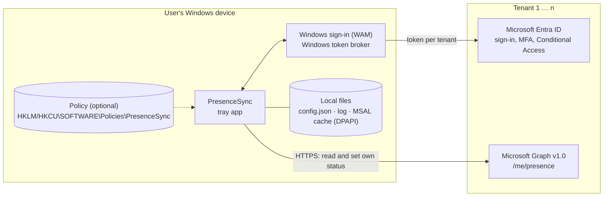
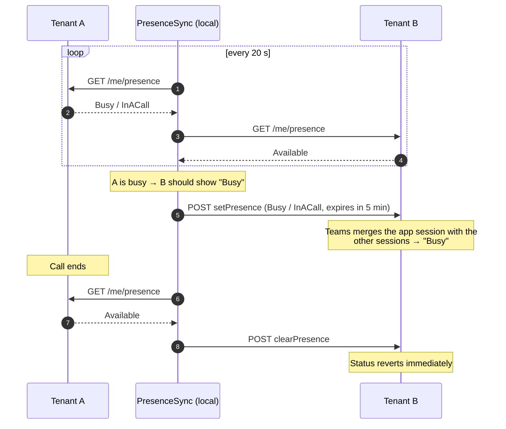

# Architecture

Technical reference for PresenceSync: components, sign-in, sync logic, Graph calls, data flows and locally stored
data. Overview: [README](../README.md). Permissions and consent from a customer tenant's perspective:
[consent.md](consent.md).

## Overview

- **Local, no backend:** There is no publisher server. The only network endpoints are `login.microsoftonline.com`
  and `graph.microsoft.com`.
- **One sign-in context per tenant:** For each tenant the user signs in with their account there. Tokens from one
  tenant are never used against another tenant.
- **Official APIs only:** Microsoft Graph v1.0 with its own app registration and delegated permissions; no
  first-party client IDs, no undocumented endpoints.

## Components

| Project | Responsibility | Dependencies |
| --- | --- | --- |
| `src/PresenceSync.Core` | Sync decisions (`SyncPlanner`, pure function), state machine (`SyncEngine`), configuration and policies (`PolicyApplier`), strings, error catalog, log filter | only `Microsoft.Extensions.Logging.Abstractions` – no UI, no HTTP, no MSAL; fully unit-tested |
| `src/PresenceSync.Graph` | Sign-in with MSAL and WAM per tenant (`TenantAuthenticator`), lean Graph client, mapping errors to `AuthRequired` / `Disabled` / `Throttled` / `Transient` | Core, MSAL |
| `src/PresenceSync.App` | WPF UI (WPF-UI, Fluent), tray icon (H.NotifyIcon), settings, polling loop, Windows events, logging (Serilog) | Core, Graph |
| `tests/PresenceSync.Core.Tests` | xUnit; a simulated Teams (`FakePresenceGateway`) reproduces Graph's status aggregation | Core |

Runtime: .NET 10, shipped as a self-contained single file `PresenceSync.exe` (win-x64); no installation and no
administrator rights required.

## Sign-in

- **MSAL with the Windows broker (WAM):** The app uses the same Windows sign-in as Teams and Office – single sign-on,
  MFA, device state and Conditional Access of each tenant apply unchanged. If WAM is not available, MSAL falls back to
  the system browser.
- **A fixed authority per tenant** `https://login.microsoftonline.com/{tenant-id}`. Only when a tenant is added via
  the account picker is `organizations` used once; the tenant ID is read from the result. Guest accounts specify the
  tenant ID explicitly.
- **Background tokens** are renewed silently (`offline_access`). If that fails (MFA due, consent revoked,
  Conditional Access), the app shows "Sign-in required" or "Blocked: …" with the reason in plain language. **A sign-in
  dialog never opens automatically**, only after the user clicks.
- **One account per tenant.** If the user picks a different account for a tenant that is already set up, the app asks
  for confirmation and shows the previous and the new account (member or guest).
- **Managed home tenant:** If a policy sets the home tenant, the app signs in with the Windows account without user
  interaction – but only if that account is a member account of exactly this tenant.

## Sync logic

The app queries the user's own status in all active tenants in parallel, every 20 seconds by default.

1. **Determine sources:** A tenant is a *source* if the user is in a call, a conference call or a meeting there, is
   presenting or set to "Do not disturb" – and the app does **not** hold its own session there.
2. **Set targets:** If there is at least one source, the app sets its own session via `setPresence` in all other
   active tenants: `Busy/InACall`, or `DoNotDisturb/Presenting` if the source is set to "Do not disturb" or is
   presenting. Expiration 5 minutes; renewed only when less than 2 minutes remain.
3. **Reset:** When there is no source any more, the app ends its sessions immediately with `clearPresence`.

Rules that prevent misbehavior:

| Rule | Purpose |
| --- | --- |
| A tenant with its own app session is never a source | No feedback loop (A sets B, B sets A …) |
| After a session ends, the same status is not treated as a source for 60 s | Graph briefly keeps reporting the old status; without this guard there would be ping-pong |
| Manual status takes precedence | As long as the user has set a status manually in a tenant, sync sets nothing there |
| Teams precedence: manual > sessions; DnD > Busy > Available > Away | The app never hard-overwrites anything; "Do not disturb" set in Teams stays in place |

Known limitation: if a real call starts in a tenant where the app currently holds its own session, the app only
recognizes it as a source once its session has ended – Graph only returns the aggregated status.

## Graph calls

Complete list, all Microsoft Graph v1.0, all in the context of the signed-in user:

| Call | Purpose | Frequency |
| --- | --- | --- |
| `GET /me/presence` | read own status | every 20 s (configurable 10–300 s) |
| `GET /me?$select=id` | own object ID, if not yet known | once |
| `GET /organization?$select=displayName` | tenant name as suggested label | once when adding |
| `POST /users/{own ID}/presence/setPresence` | set or renew own app session | about every 3 min during a call in another tenant |
| `POST /users/{own ID}/presence/clearPresence` | end own app session | when the call ends, when the app exits, on Windows sign-out |
| `POST /users/{own ID}/presence/setUserPreferredPresence` | manual status | only when the user clicks |
| `POST /users/{own ID}/presence/clearUserPreferredPresence` | reset manual status | only when the user clicks |

The `sessionId` for `setPresence` is the app's client ID. For a manual status without a duration ("Unlimited") the
Graph default applies: 1 day for Busy/Do not disturb, otherwise 7 days.

## Data flow during auto-sync

**The only thing transferred between tenants** is the derived state "busy" or "do not disturb", technically one of the
two fixed combinations `Busy/InACall` or `DoNotDisturb/Presenting`. Call partners, meeting subjects, participants,
times or content never reach another tenant. The only path is through the user's device.

The response of `GET /me/presence` also contains fields such as the status message or out-of-office settings.
PresenceSync only evaluates `availability` and `activity` and neither stores nor transfers the rest.

## Stored data

| Data | Location | Retention |
| --- | --- | --- |
| Status per tenant | memory only | until the next poll |
| Tenant ID, display name, sign-in name (UPN), settings | `%APPDATA%\PresenceSync\config.json` | until the tenant is removed or the app is uninstalled |
| Account and token metadata | `%LOCALAPPDATA%\PresenceSync\msal.cache`, bound to the user with Windows DPAPI; refresh tokens are managed by Windows (WAM) | until sign-out or expiry |
| Operational log | `%LOCALAPPDATA%\PresenceSync\logs`; sign-in names masked, tokens filtered out | 14 days rolling |
| Telemetry, usage data | – | **none** |

## Robustness

- **Errors stay per tenant:** A blocked, unreachable or throttled tenant does not hold up the others.
- **Throttling (HTTP 429/503):** `Retry-After` is honored, otherwise exponential backoff per tenant (10 s … 5 min).
- **Network loss:** Polling pauses and resumes immediately after reconnecting.
- **Standby:** Immediate poll after wake-up; expired sessions are detected.
- **Exit, sign-out, shutdown:** The app actively ends its own sessions; if that fails, they expire after 5 minutes at
  most.

## Configuration and policies

Precedence: computer policy (HKLM) > user policy (HKCU) under `SOFTWARE\Policies\PresenceSync` > `config.json`.
Policies can set the client ID (which is then locked) and add the home tenant. Details:
[deployment.md → Policies](deployment.md#2-policies).
